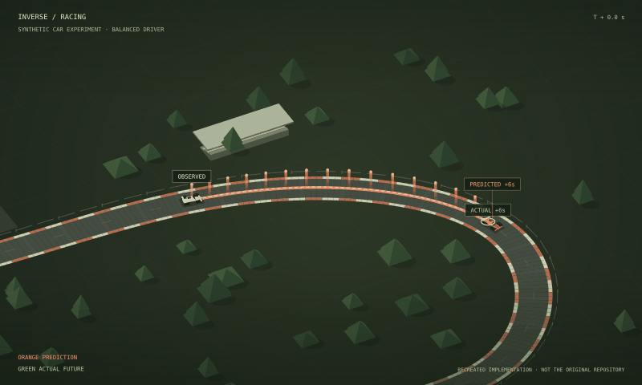
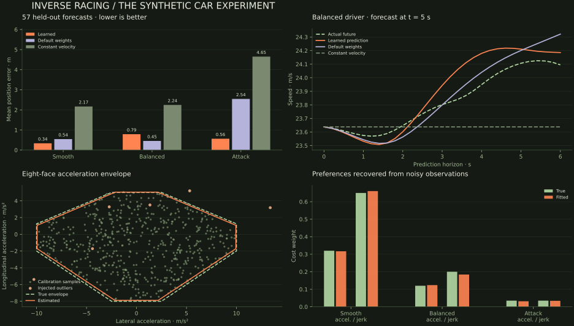

<div align="center">

# Inverse Racing

**Learn the driver. Anticipate the drive.**

A runnable recreation of inverse optimal control for autonomous race-car trajectory prediction.

[Original paper](https://arxiv.org/abs/2204.01494) · [Interactive landing page](docs/index.html) · [Results](docs/data/summary.json) · [Method & scope](REPRODUCTION.md)




</div>

> **This is a recreated implementation, not the original repository.** It uses synthetic data and a simplified solver stack. It does not reproduce the original Roborace recordings, hardware deployment, or all numerical results of the paper.

This project accompanies **“An Inverse Optimal Control Approach for Trajectory Prediction of Autonomous Race Cars”**, Rudolf Reiter, Florian Messerer, Markus Schratter, Daniel Watzenig, and Moritz Diehl, ECC 2022. [Paper and publication information](https://arxiv.org/abs/2204.01494).

The idea is compact: assume a car trades progress against smooth acceleration and jerk. Observe its motion, learn two interpretable cost weights, and use the resulting constrained optimal-control problem to predict its future.

## Explore it

Open `docs/index.html` directly, or serve the page:

```bash
python -m http.server 8000 --directory docs
```

Visit **http://localhost:8000**. The page is entirely static and requires no Node dependencies, external fonts, API keys, or server-side optimizer.

- Three driver profiles: **Smooth**, **Balanced**, and **Attack**.
- A projected 3D circuit, animated race cars, speed pillars, and future-position markers.
- Stationary, smoothly following, circuit, and top cameras; a replay timeline and speed control.
- Synchronized speed and error plots, learned acceleration envelopes, weight estimates, and numerical comparisons.
- JSON download and source package, with offline replay support and reduced-motion handling.

The scene replays real outputs from this repository’s Python simulation. Each forecast stays fixed for six seconds. The actual car and orange prediction ghost advance at the same elapsed time; the final error is held briefly before a new forecast begins. Playback starts paused and stops at the end of the drive. A distance ruler and synchronized chart cursors expose small errors. You can compare learned preferences, default weights, and constant velocity. Cars are enlarged for visibility. The blue car follows held-out simulated motion. This is an offline evaluation, not a live sensor feed.

## Run the car example

Python 3.9+ is supported. Python 3.11 is a convenient choice for a fresh environment.

```bash
python -m venv .venv
source .venv/bin/activate
pip install -e '.[dev]'

# Fit preferences and evaluate all three race-car drivers.
inverse-racing

# Numerical validation.
pytest -q

# Regenerate the figures and downloadable source bundle.
python scripts/plot_results.py
python scripts/build_site.py
```

On Windows, activate with `.venv\Scripts\activate` instead. For the dependency versions used to produce the committed results, install `requirements-reproduce.txt` before `pip install --no-deps -e .`.

`inverse-racing` writes `docs/data/experiment.json`, its offline browser companion `experiment.js`, and `summary.json`. The seed defaults to **7**. For a shorter smoke run, use `inverse-racing --quick --output artifacts/quick.json`; this leaves the published data unchanged.

## What is implemented?

| Component | This recreation |
|---|---|
| State and dynamics | Exact zero-order-hold triple integrator, state `[s, v, a]`, input jerk |
| Forward prediction | Progress reward, acceleration/jerk penalties, speed limits, eight acceleration inequalities |
| Constraint estimation | Symmetric polytope; scalar convex hinge objectives equivalent to eliminating the QP slacks |
| Preference estimation | Positive weights fitted by nested forward solves and nonlinear least squares |
| Robustness | Optional, explicitly reported shared envelope slack when hard constraints cannot be solved |
| Geometry | Synthetic periodic reference circuit; separately available smooth path-blending utility |
| Evaluation | Noisy independent training windows, matched-horizon holdouts, and receding-horizon race-car drives |

The original KKT/MPCC inverse solver, minimum-curvature path optimization, sensor-state estimator, ROS threads, acados, IPOPT, and embedded implementation are outside this recreation. See [REPRODUCTION.md](REPRODUCTION.md) for equations, conventions, and limitations.

## Car evaluation

Three 24-second receding-horizon drives supply **57 overlapping six-second forecasts**. Each driver replans every 0.2 s; the predictor is evaluated every 1 s. Training consists of three separate noisy six-second windows per driver. Forecast futures are not used for fitting.

| Predictor | Smooth ADE | Balanced ADE | Attack ADE | Overall ADE |
|---|---:|---:|---:|---:|
| **Learned preferences** | **0.335 m** | **0.789 m** | **0.564 m** | **0.563 m** |
| Default weights | 0.544 m | 0.453 m | 2.545 m | 1.181 m |
| Constant velocity | 2.168 m | 2.245 m | 4.651 m | 3.021 m |

*The table is regenerated by `scripts/plot_results.py`; the machine-readable output is the source of truth. ADE excludes the identical initial state. Constant velocity follows the same curved reference path.*

Learning improves the aggregate and two profiles in this run. Default weights perform better on the balanced profile; fitting training trajectories does not guarantee the best prediction under receding-horizon mismatch.



These are **synthetic sanity checks, not evidence of performance on real race cars**. Training and evaluation share a dynamics family and track. The calibration uses idealized acceleration samples and a nominal prior equal to the simulator’s axis limits before shrinkage. The benchmark is favorable to the assumed model; overlapping forecast windows are correlated. In the committed run, three learned forecasts use a small acceleration-envelope relaxation (maximum 0.0612 m/s²). The complete trajectories, weights, calibration samples, solver diagnostics, and provenance are included in the JSON.

## Use the optimizer

```python
from inverse_racing import Track, Predictor, Weights

track = Track()
predictor = Predictor(track)
prediction = predictor.solve(
    initial=[0.30 * track.length, 19.0, 0.0],
    weights=Weights(acceleration=0.12, jerk=0.20),
)

xy = track.xy(prediction.states[:, 0])
print(prediction.states.shape)  # (31, 3): progress, speed, acceleration
print(prediction.min_margin)    # acceleration feasibility diagnostic
```

An infeasible initial state or failed solver raises `OptimizationError`. To permit the documented soft-envelope fallback, pass `allow_slack=True` and inspect `prediction.constraint_relaxation`. Positive slack means the fitted acceleration bounds were relaxed; it must not be presented as strict feasibility.

## Repository map

```text
src/inverse_racing/
  model.py         exact dynamics and condensed sensitivities
  track.py         circuit, curvature, path blending
  constraints.py   acceleration polytope and robust bound estimation
  predictor.py     constrained forward optimizer
  inverse.py       nested preference fitting
  experiment.py    training, held-out car replay, metrics, export
docs/              static interactive landing page
  data/            committed experiment and provenance
  assets/          figures, animated driving preview, source download
scripts/           plots, scene export, packaging, static validation
tests/             numerical and exported-data checks
.github/workflows/ tests and GitHub Pages deployment
```

## Publish on GitHub

The repository is prepared for `RudolfReiter/inverse-racing`. Once it exists on GitHub, enable **Settings → Pages → Source → GitHub Actions**. The included Pages workflow deploys `docs/` on pushes to `main`. All page assets use relative URLs so the project subpath works.

The release bundle can be built with `python scripts/build_site.py`. The Sites hosting manifest is specific to this working checkout; it is excluded from downloadable source bundles.

## Citation

Please cite the original paper when building on its method. This recreation’s software is MIT licensed; that license does not relicense the paper or original implementation.

```bibtex
@inproceedings{reiter2022inverse,
  title={An Inverse Optimal Control Approach for Trajectory Prediction of Autonomous Race Cars},
  author={Reiter, Rudolf and Messerer, Florian and Schratter, Markus and Watzenig, Daniel and Diehl, Moritz},
  booktitle={2022 European Control Conference (ECC)},
  year={2022},
  doi={10.23919/ECC55457.2022.9838100},
  eprint={2204.01494},
  archivePrefix={arXiv}
}
```
